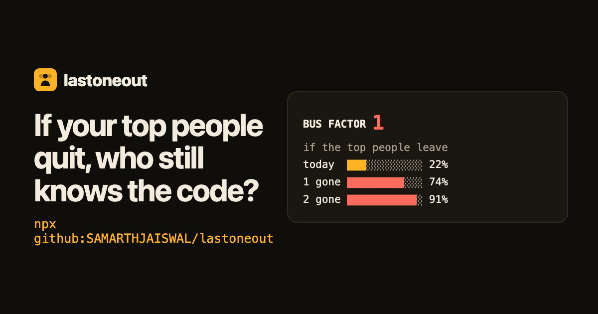

# lastoneout

[](https://github.com/SAMARTHJAISWAL/lastoneout/actions/workflows/ci.yml)
[](https://lastoneout.vercel.app/)
[](LICENSE)

**If your top people quit tomorrow, who still knows the code?**

One command reads your git history and tells you your **bus factor**: how many people can leave before most of your code has no active author. It also shows who holds what, which folders depend on one person, and who is best placed to take over.

```sh
npx github:SAMARTHJAISWAL/lastoneout
```

Run it inside any git repository. You need Node 18 or newer and git. There's nothing to install or sign up for, and nothing is uploaded.

[](https://lastoneout.vercel.app/)

## What you get

This is real output, for a made-up team:

```

  lastoneout · acme-api
  120 code files · 18 commits · 4 people, 3 active

  BUS FACTOR  1
  If one person leaves, more than half of this code has no active author.

  IF THE TOP PEOPLE LEAVE, ONE AT A TIME
  today   ███░░░░░░░░░░░░░░░░░░░░░░░░░░░ 10% of the code without an author
  1 gone  ████████████████████░░░░░░░░░░ 67% of the code without an author
  2 gone  ██████████████████████████████ 100% of the code without an author

  WHO HOLDS IT
  Priya Nair  68 files    57%  68 alone  last commit 3 days ago
  Marcus Lee  40 files    33%  40 alone  last commit 5 days ago

  ALREADY WITHOUT AN AUTHOR
  12 files (10%) have no main author who committed in the last 12 months.

  ONE DEPARTURE FROM TROUBLE
  src/                       94 files   only Priya Nair
  web/                       26 files   only Marcus Lee
```

Then ask what would happen if someone actually left:

```
$ lastoneout --what-if "Priya"
  WHAT IF Priya Nair leaves?
  68 files (57%) would be left with no active author.
  Code without an author would reach 67%. Bus factor: 1 → 0.

  HARDEST HIT
  src/                       68 files

  BEST PLACED TO TAKE OVER
  Dana Weiss: has touched 20 of those files
```

## How famous projects score

[The leaderboard](https://lastoneout.vercel.app/) measures 38 well-known open-source projects from their full history. By the published method, **14 of the 38 have a bus factor of 1**, and 25 have 2 or less. Each project has a curve showing how fast its code loses its authors. The leaderboard shows totals only and names no individuals.

These numbers are easy to over-read, so see [what it can't see](#what-it-cant-see).

## Options

| | |
|---|---|
| `lastoneout [repo]` | report on a repository (default: the current one) |
| `--what-if NAME` | what breaks if this person leaves, and who could take over (repeatable) |
| `--path DIR` | look at one folder |
| `--gone-after N` | months without a commit before someone counts as gone (default 12) |
| `--all-files` | count every text file, not just code |
| `--top N` | how many people to list |
| `--min N` | exit 1 if the bus factor is below N |
| `--badge` | print a README badge |
| `--share` | print a link to a card with totals and no names |
| `--json` | the numbers, as JSON |

Fail a build when knowledge gets too concentrated:

```yaml
- uses: actions/checkout@v4
  with:
    fetch-depth: 0   # the whole history is needed
- run: npx github:SAMARTHJAISWAL/lastoneout --min 2
```

## How it works

The model comes from Avelino, Passos, Hora and Valente, [“A Novel Approach for Estimating Truck Factors”](https://arxiv.org/abs/1604.06766) (ICPC 2016).

1. **Pick the code.** It takes the files at `HEAD` and skips third-party folders, generated files, docs, examples and data ([`src/filter.js`](src/filter.js)).
2. **Trace each file** through `git log --find-renames`.
3. **Merge identities.** One person's different names and emails become one person, including GitHub's noreply addresses. Bots are dropped.
4. **Score authorship** for each person on each file:

   ```
   DOA = 3.293 + 1.098 × created it + 0.164 × their changes − 0.321 × ln(1 + others' changes)
   ```

   You're an author if your score is at least 3.293 and above 75% of the file's top score.
5. **Remove the biggest author, repeatedly,** until the remaining authors cover less than half of the files. The number removed is the bus factor.

lastoneout adds one thing to the paper: its headline number first removes anyone with no commit in the last 12 months, because someone who left in 2019 can't answer your question today. The report also gives the number without that step, and the leaderboard ranks by it.

## What it can't see

A bus factor is a prompt for a conversation, not a measurement of people.

- **It only sees commits.** Reviewers, maintainers who mostly merge other people's work, and knowledge in people's heads don't show up.
- **Squash merges and big imports** credit whoever made the commit.
- **A low score doesn't mean a project is neglected.** Several projects with very active maintainers score 0 in the strict view, because the people who wrote most of the code have moved on.
- **The greedy method gives an estimate.** It's a well-tested heuristic, not an exact answer.

## Private by design

Everything runs on your machine, and the only program it starts is `git`. `--share` makes a link holding totals and the repository's name, after the `#`, which browsers don't send to the server. It never includes anyone's name.

## Development

There are no dependencies.

```sh
npm test         # the model, and the CLI end to end on real temporary repositories
npm run survey   # re-measure the leaderboard (clones every project)
npm run build    # the web page, into _site/
```

## License

[MIT](LICENSE)
